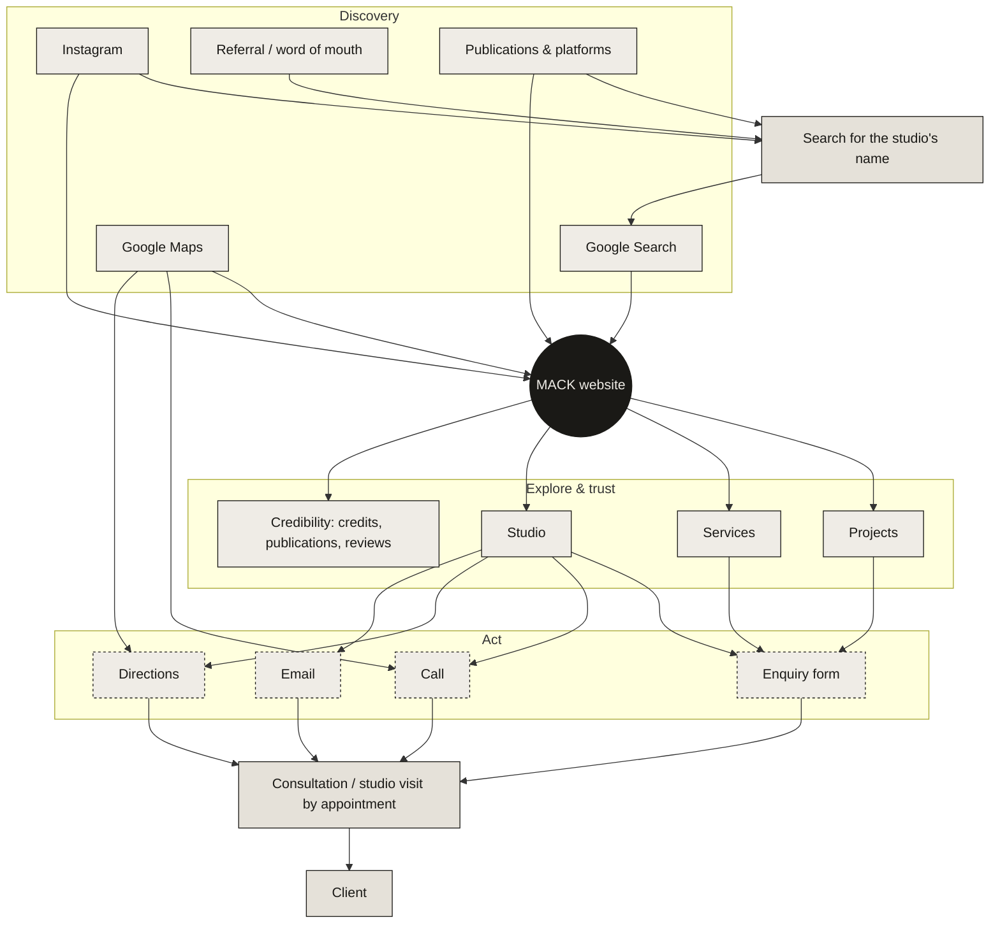

# 05 — Digital ecosystem

The website as MACK's **digital destination**: the place every discovery channel leads to, and where intent turns into an enquiry.

## 1. The journey



Plain-text version (for the meeting):

```
DISCOVER        Search · Maps · Instagram · Referral · Publications
                        │   (most referrals pass through a name search)
                        ▼
DESTINATION              MACK WEBSITE
                        │
EXPLORE         Projects · Services · Studio · Credibility
                        │
ACT             Enquiry · Call · Directions · Email
                        │
MEET            Consultation / studio visit (by appointment)
```

## 2. Where each component fits

| Component | Where it acts in the journey | What it changes |
|---|---|---|
| **SEO (technical + on-page)** | Discover → Destination | Whether Google can find, understand and show MACK's pages, and for which searches |
| **Google Business Profile** | Discover (Maps, name search) → Act | The studio's card on Google: name, location, photos, reviews, call and directions buttons, website link |
| **Website UX** | Destination → Explore → Act | Whether a visitor finds the work, understands the studio and knows how to get in touch |
| **Portfolio architecture** (project pages, taxonomy, links) | Discover (project and image searches) → Explore | Turns each project into an entry point, and moves visitors from one project to related work and to contact |
| **Authority** (publications, platforms, collaborators) | Discover (referral-like trust) | Gives referred clients independent confirmation, and gives Google evidence of prominence |
| **Analytics + Search Console + Profile metrics + enquiry log** | Across all stages | Shows which channel, query and project leads to real enquiries |
| **Professional email** | Act → Meet | The first reply comes from `name@<domain>`, the same identity as the website and profile |
| **Ongoing optimisation** | Loop around all stages | Monthly: read the data, fix what's broken, improve what's working, publish new work |

## 3. The infrastructure behind it

```
                         ┌──────────────── DOMAIN (owned by MACK) ────────────────┐
                         │                                                         │
      Website ◄──── DNS ─┤── MX/SPF/DKIM/DMARC ──► Google Workspace (email · Drive) │
         │               │── TXT verification ───► Search Console                  │
         │               └─────────────────────────────────────────────────────────┘
         ├──► Google Analytics 4 ◄──── link ────► Search Console
         ├──► Business Profile (website link, UTM-tagged)
         └──► Enquiry form ──► studio inbox ──► Enquiry log (source · qualified · outcome)

      Google Workspace shared drives ──► independent backup (NAS / backup service) ──► off-site copy
```

**The domain is the root.** Website, email, Search Console verification and the Workspace account all hang off it. That is why it must be registered in MACK's name and decided first.

## 4. Impact model: work → immediate output → business impact

The right-hand column says what becomes **possible and measurable**. It is not a guaranteed number.

| Work | Immediate output | Business impact | Measured by |
|---|---|---|---|
| Launch with indexing on + technical SEO | Google can crawl and index every page | MACK becomes **eligible** to appear in search at all (today it isn't) | Indexed pages (Search Console) |
| Site-name & organisation markup, consistent naming | Google shows "MACK & Co Architects" clearly for name searches | Referred clients find the right studio, not the US "Mack" | Branded CTR, branded clicks |
| Google Business Profile (verified, complete) | The studio's card on Google Search and Maps | Calls, directions and website visits become possible from Google, and measurable | Profile calls / directions / website clicks |
| Project pages to the standard | Each project is findable on its own | The portfolio can reach people searching for similar work, places or typologies | Non-branded impressions/clicks per project; organic landings |
| Image naming, alt text, credits | Images understood (and credited) in Google Images | Visual discovery that leads back to the studio | Image search clicks |
| Service pages | One clear page per real service | MACK can be considered for service searches, not only for its name | Non-branded impressions to service pages |
| Reviews process (within Google's rules) | Steady, genuine client reviews | Stronger trust signals and local prominence | Review count/rating trend |
| Publications & platforms | Independent mentions and links | Validation for referred clients; prominence for Google | Referring domains, branded search trend |
| GA4 key events + enquiry log | Enquiry sources become visible | Decisions based on evidence; effort goes where enquiries come from | Enquiries and qualified enquiries by source |
| Domain + studio email | One identity owned by the studio | Trust at first contact; no lost access when people change | Authentication pass; accounts owned by MACK |
| Shared drives + permissions | Every project in one structure | Faster collaboration, controlled client sharing | Projects in structure; permission audit |
| Independent backup + restore tests | A recoverable copy of every project | The studio's archive survives mistakes and incidents | Last backup / last restore test |
| Monthly maintenance & monitoring | Problems found within a month | No silent failures (broken form, deindexed page, paused site) | Health checklist in each report |

## 5. Visual for the deck

The client deck (`06-client-deck/`) shows this as:

- **Slide 3 (The digital destination):** five discovery channels → the website as a dark central node → four explore nodes → four actions → consultation. Small labels show where SEO, Business Profile, UX, portfolio and analytics act.
- **Slide 4 (One connected system):** the domain at the centre, with website, email, workspace, Search Console, analytics and Business Profile around it, and the backup copy set apart.
